  

### 🛠️ Projects & Contributions

- **[smart-causalEO](https://github.com/strath-ace-labs/smart-causalEO)** 
  Causal inference and Explainable AI for Earth Observation.
  
### 📍 Where to find me

  
  
  
  

  <picture>
    <source media="(prefers-color-scheme: dark)" srcset="https://raw.githubusercontent.com/BogdanPri/BogdanPri/output/pacman-contribution-graph-dark.svg">
    <source media="(prefers-color-scheme: light)" srcset="https://raw.githubusercontent.com/BogdanPri/BogdanPri/output/pacman-contribution-graph.svg">
    
  </picture>

